<div align="center">

# 🛰️ Private Network Service Platform

**A four-Mac private network that serves one HTTPS service through our own DNS, a TLS reverse proxy and two load-balanced backends. It keeps serving when parts of it fail.**

*Computer Networks course project, Team 1. Phase 1 (build) and Phase 2 (harden, recover, troubleshoot).*


> *“The application stays simple; the network is the project.”*

</div>

---

## Table of contents

1. [What this project is](#1-what-this-project-is)
2. [Team and machine map](#2-team-and-machine-map)
3. [Architecture](#3-architecture)
4. [One request, end to end](#4-one-request-end-to-end)
5. [Phase 1: building the platform (Tasks A–G)](#5-phase-1-building-the-platform-tasks-ag)
6. [Phase 2: harden, recover, troubleshoot (Extensions A–F)](#6-phase-2-harden-recover-troubleshoot-extensions-af)
7. [Repository layout](#7-repository-layout)
8. [Configuration reference](#8-configuration-reference)
9. [Running and verifying the platform](#9-running-and-verifying-the-platform)
10. [Troubleshooting playbook](#10-troubleshooting-playbook)
11. [Security model](#11-security-model)
12. [Limitations and what production would need](#12-limitations-and-what-production-would-need)
13. [Project timeline](#13-project-timeline)
14. [Team contributions](#14-team-contributions)

---

## 1. What this project is

Four MacBooks on one Wi-Fi LAN act as a small private data centre:

| Layer | What we built | Why it matters |
|---|---|---|
| **Naming** | Two `dnsmasq` resolvers that answer `app.team1.test` and `api.team1.test` | Clients use a stable name, never a hard-coded IP |
| **Entry point** | An `nginx` edge on TCP **8443** that terminates **TLS** with a certificate from our own CA | One trusted, encrypted front door |
| **Load balancing** | An nginx `upstream` pool with round-robin and passive failover | Requests spread across backends and survive a backend outage |
| **Application** | Two tiny dependency-free Node.js HTTP servers (**A** and **B**) | Deliberately simple, so the *network* behaviour is observable |
| **Caching** | `Cache-Control`, `ETag` / `304` in HTTP; a 30-second **TTL** in DNS | Two different caches at two different layers |
| **Isolation** | macOS **PF** packet-filter rules on each backend | Only the edge may talk to the backends directly |
| **Resilience** | Backup DNS, backend failover and a standby edge | Each single point of failure has a recovery path |

**Phase 1** proved that the service works. **Phase 2** proved what happens when it breaks, and showed how we restored it. Every claim in this README links to the raw terminal evidence in [`evidence/`](evidence/).

---

## 2. Team and machine map

All four Macs sit on the Wi-Fi subnet **`10.7.0.0/19`** (mask `255.255.224.0`, gateway `10.7.0.1`, broadcast `10.7.31.255`). Phase 1 ran on an earlier network, `10.253.140.0/24`.

| Member | Machine IP | Services (Phase 2) | Ports |
|---|---|---|---|
| **Rajat** *(team lead)* | `10.7.10.96` | Primary DNS (dnsmasq), cutover coordination, integration | UDP/TCP **53**; temporary TTL probe on **1053** |
| **Anand** | `10.7.2.253` | **Main nginx edge** (TLS, load balancer), DNS-cache test client | TCP **8443**; cache on `127.0.0.1:5533` |
| **Rajdeep** | `10.7.12.140` | **Backend A**, **standby nginx edge**, PF for Backend A | TCP **3001**, TCP **8443** |
| **Omved** | `10.7.26.0` | **Backup DNS**, **Backend B**, PF for Backend B | UDP/TCP **53**, TCP **3002** |

> **Is `10.7.26.0` a valid host?** Yes. In a `/19` the network address is `10.7.0.0` and the broadcast address is `10.7.31.255`. `10.7.26.0` is neither, so it is a normal host address even though it ends in `.0`.

---

## 3. Architecture

### 3.1 Normal operation

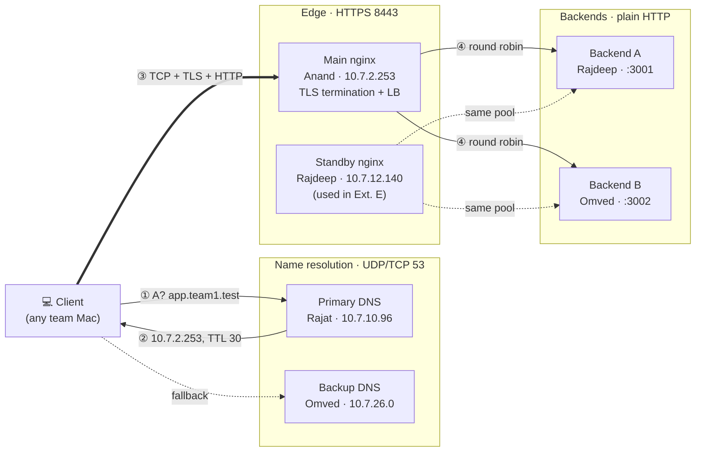

The key idea is that **DNS and HTTPS are two separate network operations.** DNS only tells the client *where* the edge is. The client then opens its *own* TCP connection and TLS session to nginx. nginx, not DNS, chooses the backend.

### 3.2 Trust and protocol boundaries

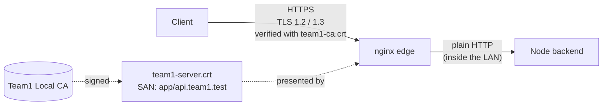

- **TLS ends at nginx.** The hop from nginx to a backend is plain HTTP on the private LAN.
- The certificate is trusted because the client trusts **our CA** (`config/tls/team1-ca.crt`). We never use `curl -k`.
- The certificate names the **hostnames** (`app.team1.test`, `api.team1.test`). That is why the *same* certificate also validates on the standby edge at a different IP.

---

## 4. One request, end to end

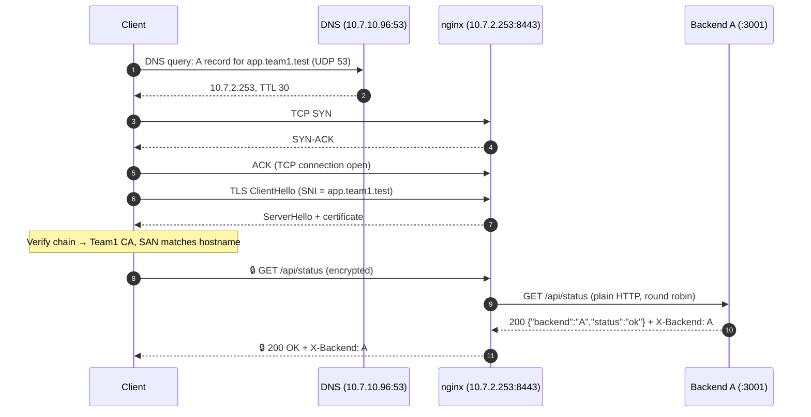

| Step | Layer | Protocol | What to look for |
|---|---|---|---|
| 1–2 | Application | DNS over UDP 53 | `dig @10.7.10.96 app.team1.test` returns `10.7.2.253` |
| 3–5 | Transport | TCP 3-way handshake | `SYN → SYN-ACK → ACK` in Wireshark |
| 6–8 | Security | TLS | `SSL certificate verify ok` in `curl -v` |
| 9–12 | Application | HTTP inside TLS, then HTTP upstream | `HTTP/1.1 200`, `X-Backend: A` or `B` |

---

## 5. Phase 1: building the platform (Tasks A–G)

*October 2026, on the `10.253.140.0/24` network.*

| Task | Goal | What we did | Evidence |
|---|---|---|---|
| **A: Private LAN** | All four Macs reachable | Pairwise ping between all four machines, 0% loss | [task-a](evidence/phase1/task-a/) |
| **B: Private DNS** | Names instead of IPs | dnsmasq answers `app/api.team1.test` with the edge IP, TTL 30; the public DNS answer is NXDOMAIN | [task-b](evidence/phase1/task-b/) |
| **C: Backends** | Two HTTP services | Node.js Backend A on `:3001` and Backend B on `:3002`, identified by the `X-Backend` header | [task-c](evidence/phase1/task-c/) |
| **D: Reverse proxy + LB** | One entry point | nginx `upstream backend_pool`; repeated requests alternate A/B (round robin) | [task-d](evidence/phase1/task-d/) |
| **E: HTTPS / TLS** | Encrypted, trusted edge | Own **Team1 Local CA**; server cert with SANs; HTTPS on `:8443` without `-k` | [task-e](evidence/phase1/task-e/) |
| **F: HTTP caching** | Freshness and validation | `Cache-Control: public, max-age=60`; `/api/cache` returns `ETag: "cache-v1"` → `If-None-Match` → **304** | [task-f](evidence/phase1/task-f/) · [explanation](evidence/phase1/task-f/caching-explanation.md) |
| **G: Protocol flow** | See it on the wire | Wireshark: DNS query/answer, TCP handshake, TLS handshake, encrypted application data | [task-g](evidence/phase1/task-g/) |
| **D3: Failure demo** | Diagnose by layer | Wrong port `9999` → TCP RST (Layer 4); DNS still fine; fixed by using `8443` | [failures](evidence/phase1/failures/) |

### The backend in one glance (`backend/server.js`)

| Route | Response | Extra headers |
|---|---|---|
| `GET /` | `{"service":"private-network-backend","backend":"A","status":"ok"}` | `X-Backend`, `Cache-Control: public, max-age=60` |
| `GET /api/status` | `{"backend":"A","status":"ok"}` | `X-Backend`, `Cache-Control` |
| `GET /api/cache` | `{"service":…,"cache":"ok","status":"stable"}` | plus `ETag: "cache-v1"`; returns **304** if `If-None-Match` matches |
| anything else | `404 {"error":"Not Found"}` | `X-Backend` |

The same file runs as both backends. Only two environment variables differ:

```sh
BACKEND=A PORT=3001 node backend/server.js   # Rajdeep
BACKEND=B PORT=3002 node backend/server.js   # Omved
```

It binds `0.0.0.0`, so nginx on another Mac can reach it. That also means any LAN client can reach it, which is why Phase 2 adds PF isolation.

---

## 6. Phase 2: harden, recover, troubleshoot (Extensions A–F)

*22–23 November 2026, on the `10.7.0.0/19` network.* Every experiment followed the same pattern: **baseline → controlled change → measurement → recovery check**.

```mermaid
flowchart TB
    subgraph A_["A · Backup DNS"]
      a1[Primary DNS down] --> a2[Backup answers] --> a3[HTTPS still 200]
    end
    subgraph B_["B · TTL cache"]
      b1[Cache holds OLD IP] --> b2[Upstream already NEW] --> b3[TTL expires → NEW]
    end
    subgraph C_["C · PF isolation"]
      c1[Edge → backend ✅] --- c2[Client → backend ❌]
    end
    subgraph D_["D · Backend HA"]
      d1[Stop A] --> d2[All requests → B, 200] --> d3[Restart A → A/B again]
    end
    subgraph E_["E · Edge migration"]
      e1[DNS → standby IP] --> e2[Trusted HTTPS on standby] --> e3[DNS rolled back]
    end
    subgraph F_["F · Troubleshooting"]
      f1[DNS] --> f2[TCP] --> f3[TLS] --> f4[HTTP] --> f5[Backend / PF]
    end
```

### Results summary

| Ext. | Question | Result | Key evidence |
|---|---|---|---|
| **A** | If the primary DNS dies, can clients still resolve names? | ✅ PASS (lab) | [client during outage](evidence/phase2/A-backup-dns/anand-final-primary-down.txt) · [backup side](evidence/phase2/teammates/omved/A-backup-dns/omved-primary-down.txt) · [primary restored](evidence/phase2/A-backup-dns/rajat-after-restore.txt) |
| **B** | Does a DNS cache keep serving an old record until its TTL expires? | ✅ PASS (isolated lab) | [cache vs upstream diverge](evidence/phase2/B-ttl/anand-final-cache-change-proof.txt) · [refresh after expiry](evidence/phase2/B-ttl/anand-cache-expiry-final-proof.txt) |
| **C** | Can backends accept only the edge and refuse everyone else? | ✅ PASS (lab) | [Rajat blocked on A](evidence/phase2/C-isolation/rajat-backend-a-pf-active.txt) · [Anand allowed on A](evidence/phase2/C-isolation/anand-backend-a-pf-active.txt) · [A counters](evidence/phase2/teammates/rajdeep/C-isolation/rajdeep-pf-active-counters.txt) · [A rollback](evidence/phase2/teammates/rajdeep/C-isolation/rajdeep-pf-rollback.txt) · [B rollback](evidence/phase2/teammates/omved/C-isolation/omved-pf-rollback.txt) |
| **D** | If Backend A stops, does the service keep working? | ✅ PASS (lab) | [before](evidence/phase2/D-ha/rajat-before.txt) · [A stopped](evidence/phase2/D-ha/rajat-a-stopped.txt) · [A recovered](evidence/phase2/D-ha/rajat-after-recovery.txt) · [owner restart](evidence/phase2/teammates/rajdeep/D-ha/rajdeep-backend-a-restored.txt) |
| **E** | Can we move the whole front door to another machine with DNS? | ✅ PASS (lab) | [both DNS cut over](evidence/phase2/E-edge/rajat-cutover-dns-verified.txt) · [HTTPS on standby](evidence/phase2/E-edge/anand-standby-https.txt) · [rollback](evidence/phase2/E-edge/rajat-after-rollback.txt) · [main restored](evidence/phase2/E-edge/anand-original-edge-restored.txt) |
| **F** | Can we find a fault layer by layer instead of guessing? | ✅ PASS (lab) | [wrong-port diagnosis](evidence/phase2/F-troubleshooting/rajat-port-fault-diagnosis.txt) · [Backend A diagnosis](evidence/phase2/teammates/rajdeep/F-troubleshooting/rajdeep-backend-a-diagnosis.txt) · [recovery](evidence/phase2/F-troubleshooting/rajat-final-recovery.txt) |
| **Final** | Is everything back to normal? | ✅ at 02:25:45 IST, 23 Nov | [all services restored](evidence/phase2/final/rajat-all-services-restored.txt) |

### A. Backup DNS and failover

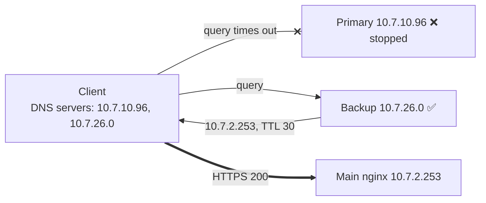

- **Problem:** with one resolver, a dead DNS server breaks *new* lookups even though nginx and both backends are healthy.
- **Design:** Omved runs an independent dnsmasq ([`config/dnsmasq/backup.conf`](config/dnsmasq/backup.conf)) with the same two records and TTL 30. The client's Wi-Fi DNS lists both servers.
- **Observed:** with the primary stopped, a direct query to the primary timed out (`dig` exit 9). The backup returned `NOERROR` with `10.7.2.253`, and ordinary HTTPS returned 200. The primary was then restored.
- **Caveat:** fallback order and delay depend on the client's resolver (macOS), and both servers must be kept consistent by hand.

### B. DNS TTL and controlled record change

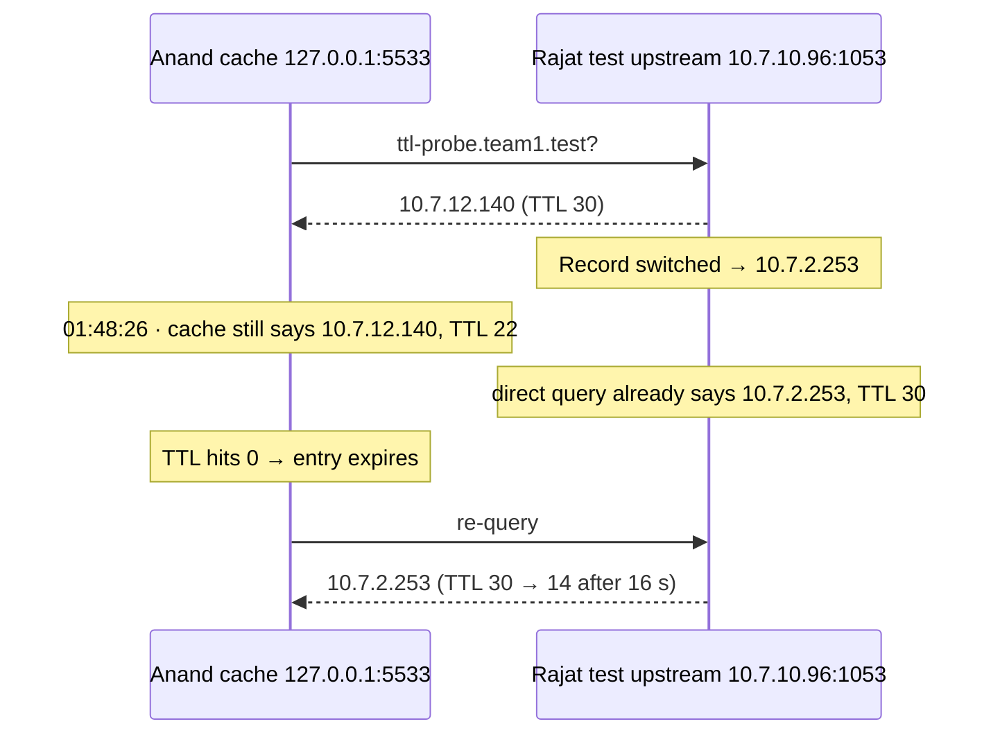

- **Problem:** a caching resolver keeps answering with the *old* address until the TTL runs out, so a DNS change is never instant.
- **Design:** an isolated test record (`ttl-probe.team1.test`) on separate ports, so production names were never at risk. The cache was [`anand-ttl-probe-cache.conf`](evidence/phase2/B-ttl/anand-ttl-probe-cache.conf), the upstream was Rajat's probe responder on `:1053`.
- **Observed:** at the same moment the cache returned **old `10.7.12.140` (TTL 22, then 21)** while the upstream returned **new `10.7.2.253` (TTL 30)**. After expiry the cache returned the new IP, counting down again from 30.
- **Note:** DNS TTL 30 s (address record) is **not** HTTP `max-age=60` (response body). They are different caches at different layers.

### C. Service isolation with macOS PF

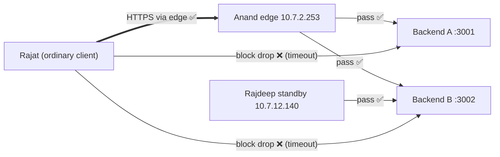

- **Problem:** backends bind `0.0.0.0`, so anyone on the LAN could bypass the edge and its TLS.
- **Design:** each backend owner loaded rules into a **separate PF child anchor** (`com.apple/900.cn-phase2-a` and `com.apple/900.cn-phase2-b`). `/etc/pf.conf` and Apple's own anchors were never touched.

  ```pf
  # Backend A (Rajdeep)
  pass in quick on en0 proto tcp from 10.7.2.253 to 10.7.12.140 port 3001 keep state
  block drop in quick on en0 proto tcp from any to 10.7.12.140 port 3001
  # Backend B (Omved): also allows the standby edge
  pass in quick on en0 proto tcp from 10.7.2.253  to 10.7.26.0 port 3002 keep state
  pass in quick on en0 proto tcp from 10.7.12.140 to 10.7.26.0 port 3002 keep state
  block drop in quick on en0 proto tcp from any to 10.7.26.0 port 3002
  ```

- **Observed:** Rajat's direct requests timed out (curl 28), while HTTPS through the edge still returned 200. The rule counters on Backend A showed **24 packets / 2 states passed** from the edge and **9 packets dropped** from others.
- **Rollback:** both owners flushed their anchors, released their own PF enable token (`pfctl -X <token>`), and confirmed `Status: Disabled`. `/etc/pf.conf` was byte-identical to the backup.

### D. Backend high availability

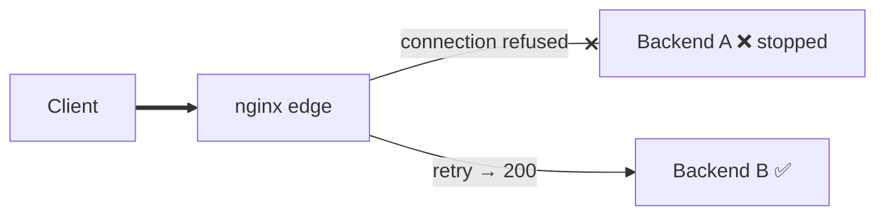

- **Design:** `upstream backend_pool` with both backends. The failover variants ([`nginx-anand-failover.conf`](config/nginx/nginx-anand-failover.conf), [`nginx-standby.conf`](config/nginx/nginx-standby.conf)) add `max_fails=1 fail_timeout=5s`, `proxy_connect_timeout 2s`, `proxy_read_timeout 5s`, `proxy_next_upstream error timeout http_502 http_503 http_504` and `proxy_next_upstream_tries 2`.
- **Observed:** the baseline gave 6 × 200 alternating A/B. With A stopped by its owner, **10/10 requests returned 200 from B**. After A restarted, both A and B served again.
- **Caveat:** this is *passive* health checking. nginx learns that A is down from failed real requests; there is no background probe.

### E. Controlled edge migration (standby nginx)

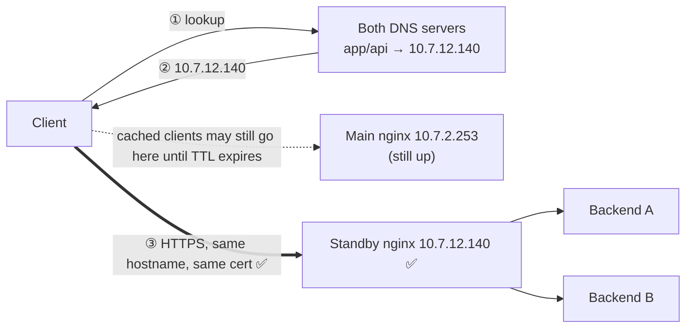

- **Problem:** two backends do not help if the single edge dies. The edge itself is a single point of failure.
- **Design:** Rajdeep runs a second nginx with the same hostnames, certificate and backend pool. Both DNS servers change *both* names to `10.7.12.140`, and later change them back.
- **Observed:** both resolvers answered the standby IP with TTL 30. Anand's **ordinary** curl (no `--resolve`, no `-k`) connected to `10.7.12.140:8443`, verified TLS and got 200. After rollback both resolvers returned `10.7.2.253` and normal HTTPS reached the main edge again.
- **Note:** the certificate still validates on a new IP because TLS checks the **hostname** (SAN), not the address.

### F. Systematic troubleshooting

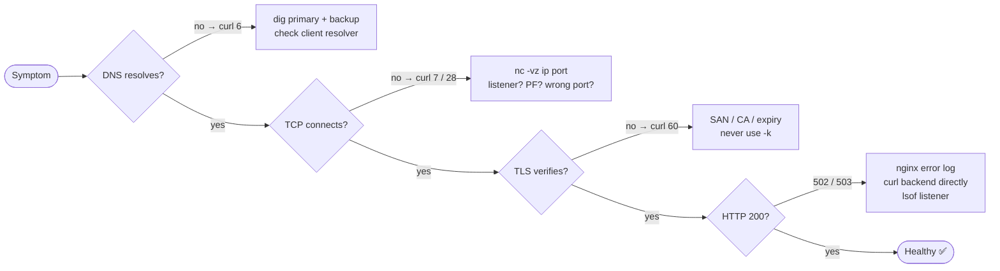

- **Recorded faults:** a request to the wrong port `8444` was refused (curl 7) while `8443` connected and returned 200. A missing Backend A listener was diagnosed and fixed by restarting it. A Backend B refusal was found and recovered.

---

## 7. Repository layout

```text
cn-private-network-platform/
├── backend/
│   └── server.js                     # Node.js backend (A or B via env vars)
├── config/
│   ├── dnsmasq/
│   │   ├── primary.conf              # Rajat · 10.7.10.96:53
│   │   ├── backup.conf               # Omved · 10.7.26.0:53
│   │   └── cache-client.conf         # Anand · 127.0.0.1:5533 test cache
│   ├── nginx/
│   │   ├── nginx.conf                # Main edge (shared, round robin)
│   │   ├── nginx-anand-failover.conf # Main edge + passive failover tuning
│   │   └── nginx-standby.conf        # Rajdeep · standby edge 10.7.12.140:8443
│   └── tls/
│       ├── team1-ca.crt              # Public CA cert (trust anchor)
│       ├── team1-server.crt          # Public server cert (SANs)
│       └── server-ext.cnf            # SAN template for re-issuing
├── docs/
│   ├── phase2-final-report.md        # Integrated Phase 2 report
│   ├── topology.md · machine-inventory.md
│   └── <member>-phase2-results.md    # Per-member logs
└── evidence/
    ├── phase1/task-{a..g}/ · failures/
    └── phase2/{A-backup-dns,B-ttl,C-isolation,D-ha,E-edge,F-troubleshooting,final}/
        └── teammates/{rajat,anand,rajdeep,omved}/
```

> 🔐 **Private keys are never committed.** `*.key` is in `.gitignore`, and each edge keeps `team1-server.key` locally.

---

## 8. Configuration reference

<details>
<summary><b>dnsmasq: <code>config/dnsmasq/primary.conf</code></b></summary>

| Directive | Meaning |
|---|---|
| `port=53` | Standard DNS port (UDP and TCP) |
| `listen-address=10.7.10.96` · `interface=en0` · `bind-interfaces` | Bind only to the Wi-Fi interface and this IP |
| `domain-needed` | Never forward plain names without a dot |
| `bogus-priv` | Never forward reverse lookups for private ranges |
| `server=8.8.8.8` | Upstream resolver for everything that is *not* ours |
| `address=/app.team1.test/10.7.2.253` | Our A record (also `api.team1.test`) |
| `local-ttl=30` | TTL (seconds) on our own answers |
| `log-queries` · `log-facility` · `pid-file` | Query log and instance identity |

`backup.conf` is identical apart from `listen-address=10.7.26.0`. `cache-client.conf` is a loopback cache (`port=5533`, `no-resolv`, `server=/team1.test/10.7.10.96`, `cache-size=1000`).
</details>

<details>
<summary><b>nginx: <code>config/nginx/*.conf</code></b></summary>

| Directive | Meaning |
|---|---|
| `listen 10.7.2.253:8443 ssl` | HTTPS listener on the edge IP |
| `server_name app.team1.test api.team1.test` | Virtual-host names |
| `ssl_certificate` / `ssl_certificate_key` | Public cert / **local-only** private key |
| `ssl_protocols TLSv1.2 TLSv1.3` | Allowed TLS versions |
| `upstream backend_pool { server A; server B; }` | Backend group, round robin by default |
| `proxy_pass http://backend_pool` | Forward decrypted request upstream |
| `proxy_set_header Host / X-Real-IP / X-Forwarded-*` | Preserve original client context |
| `max_fails=1 fail_timeout=5s` | After 1 failure, skip that backend for 5 s |
| `proxy_next_upstream … proxy_next_upstream_tries 2` | Retry on another backend, max 2 attempts |

Relative certificate paths (`../tls/…`) resolve against the **config file's directory**, not the `-p` prefix.
</details>

<details>
<summary><b>TLS: <code>config/tls/</code></b></summary>

- `team1-ca.crt`: the public CA certificate that clients trust (`curl --cacert`).
- `team1-server.crt`: the leaf certificate with `CN=app.team1.test`, SANs `app.team1.test`, `api.team1.test` and the Phase 1 IP `10.253.140.31`, valid until Jan 2029.
- `server-ext.cnf`: the SAN template for re-issuing with the new edge IP. Re-issuing requires the CA private key, which is not in the repo.
</details>

---

## 9. Running and verifying the platform

> ⚠️ Each service owner starts **only their own** service. Never run two dnsmasq instances on port 53, or two nginx instances on the same `IP:8443`.

### Start services (each on its owner's Mac, from the repo root)

```sh
# Rajat: primary DNS
sudo "$(brew --prefix)/sbin/dnsmasq" --no-daemon --conf-file="$PWD/config/dnsmasq/primary.conf"

# Omved: backup DNS + Backend B
sudo "$(brew --prefix)/sbin/dnsmasq" --no-daemon --conf-file="$PWD/config/dnsmasq/backup.conf"
BACKEND=B PORT=3002 node backend/server.js

# Rajdeep: Backend A (+ standby edge only when the lead says so)
BACKEND=A PORT=3001 node backend/server.js
nginx -t -p "$PWD/" -c "$PWD/config/nginx/nginx-standby.conf"
nginx    -p "$PWD/" -c "$PWD/config/nginx/nginx-standby.conf"

# Anand: main edge
nginx -t -p "$PWD/" -c "$PWD/config/nginx/nginx-anand-failover.conf"
nginx    -p "$PWD/" -c "$PWD/config/nginx/nginx-anand-failover.conf"
```

### Read-only health checks (any client Mac)

```sh
# DNS: ask each resolver directly
dig @10.7.10.96 app.team1.test A +noall +answer      # expect 10.7.2.253, TTL ≤ 30
dig @10.7.26.0  app.team1.test A +noall +answer

# Edge: pinned to an IP (bypasses DNS, keeps TLS hostname checks)
curl --noproxy '*' --cacert config/tls/team1-ca.crt \
  --resolve app.team1.test:8443:10.7.2.253 -i https://app.team1.test:8443/api/status

# Edge: the ordinary client path (uses the OS resolver)
curl --noproxy '*' --cacert config/tls/team1-ca.crt -v https://app.team1.test:8443/api/status

# Backends directly (only when PF isolation is off)
curl -i http://10.7.12.140:3001/api/status
curl -i http://10.7.26.0:3002/api/status

# HTTP caching: 200 then 304
curl --cacert config/tls/team1-ca.crt -i https://app.team1.test:8443/api/cache
curl --cacert config/tls/team1-ca.crt -i -H 'If-None-Match: "cache-v1"' https://app.team1.test:8443/api/cache
```

| Tool | Proves | Does **not** prove |
|---|---|---|
| `dig @server` | That *this* resolver answers | That the OS would pick it |
| `curl --resolve` | Edge TLS + HTTP, independent of DNS | That DNS works |
| `curl --cacert` | Certificate is trusted for the hostname | n/a (`-k` would skip this check) |
| `X-Backend` header | Which backend produced the response | Health of the other backend |

---

## 10. Troubleshooting playbook

| Symptom | Layer | First checks |
|---|---|---|
| `curl: (6) Could not resolve host` | DNS | `dig @10.7.10.96 …`, `dig @10.7.26.0 …`, `scutil --dns` |
| `curl: (7) Failed to connect` | TCP: nothing listening, or rejected | `nc -vz IP PORT`, on the owner: `lsof -nP -iTCP:PORT -sTCP:LISTEN` |
| `curl: (28) timed out` | Path / PF drop / host down | Compare from another source; `sudo pfctl -s info`; `ping` |
| `curl: (60) SSL certificate problem` | TLS trust or hostname | `curl -v --cacert …`, check SAN; **do not use `-k`** |
| `HTTP 502 Bad Gateway` | Edge OK, upstream failed | nginx error log; curl each backend directly |
| Old IP after a DNS change | DNS cache | Compare cache vs upstream answer; wait out the TTL |
| Direct backend blocked but HTTPS works | Intended PF isolation | Compare client source IP vs edge source IP |

> **Talk track:** *“First, does the name resolve? Then, does TCP connect to that IP and port? Then, does TLS verify? Then, what HTTP status does nginx return, and is the backend listening? I change only the failing layer, then retest end to end.”*

---

## 11. Security model

- ✅ **TLS everywhere the client sees**, with certificates from our own CA and full verification (no `-k`).
- ✅ **Private keys stay local**: `*.key` is gitignored, and keys were moved between edges only by direct AirDrop.
- ✅ **Least-privilege network access** (Ext. C): only edges may reach backend ports directly.
- ✅ **Reversible firewall changes**: anchors were isolated from system rules, the PF token was recorded, and rollback was verified.
- ⚠️ The **nginx → backend** hop is plain HTTP on the LAN; there is no mTLS.
- ⚠️ There is **no application authentication**; the API is a read-only status service.

---

## 12. Limitations and what production would need

| Lab today | Production would use |
|---|---|
| Two DNS servers kept in sync by hand | Primary/secondary zone transfer or managed DNS |
| DNS cutover, with clients waiting for TTL expiry | Virtual IP / anycast / load-balancer health checks |
| Passive nginx failover | Active health checks and monitoring/alerting |
| Plain HTTP upstream | mTLS between edge and services |
| Temporary PF anchors | Persistent, reviewed firewall policy |
| Certificate with an old Phase 1 IP SAN | Automated certificate lifecycle (e.g. ACME) |
| Point-in-time evidence | Continuous uptime and latency measurement |

---

## 13. Project timeline

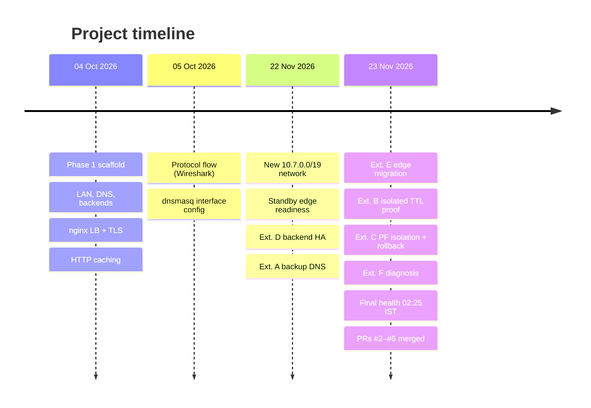

---

## 14. Team contributions

| Member | Phase 1 | Phase 2 | Where to look |
|---|---|---|---|
| **Rajat Srivastav** *(lead)* | Private DNS (Task B) | Primary DNS on `10.7.10.96:53`; coordinated every signal (D, A, E, C); ran the client-side HA loops; ran the isolated TTL upstream on `:1053`; DNS cutover and rollback; wrong-port fault diagnosis; final all-services health check; integrated all PRs and wrote the final report | [Rajat's index](evidence/phase2/teammates/rajat/README.md) · [results](docs/rajat-phase2-results.md) · [final report](docs/phase2-final-report.md) |
| **Anand Mishra** | Repo setup, LAN (A), backend, nginx LB (D), TLS/CA (E), caching (F), protocol flow (G) | Main nginx edge with passive failover; fixed the relative TLS-path bug; DNS-cache client on `127.0.0.1:5533` and the TTL old-vs-new proof (B); ordinary-HTTPS proof for backup DNS (A) and standby migration (E); allowed-source PF checks (C); supplied the server key to the standby securely | [results](docs/anand-phase2-results.md) · [report](docs/anand-phase2-report.md) |
| **Rajdeep** | Backend A (Task C) | Backend A on `10.7.12.140:3001` (stopped and restored on signal for D); built, validated and ran the **standby nginx** on `10.7.12.140:8443` with trusted TLS (E); found and stopped a stale Phase 1 nginx occupying 8443; PF isolation for Backend A in its own anchor, with counters and a verified rollback (C); Backend A layer-by-layer diagnosis (F) | [Rajdeep's evidence](evidence/phase2/teammates/rajdeep/README.md) · [results](docs/rajdeep-phase2-results.md) |
| **Omved Nagre** | Backend B (Task C), DNS verification, Wireshark client (G) | Backup DNS on `10.7.26.0:53` (A), Backend B on `:3002`, PF isolation for Backend B (allowing both edges) with counters and rollback (C), Backend B fault recovery (F) | [Omved's evidence](evidence/phase2/teammates/omved/README.md) |

<div align="center">

**Team 1** · Computer Networks Course Project · 2026

</div>
